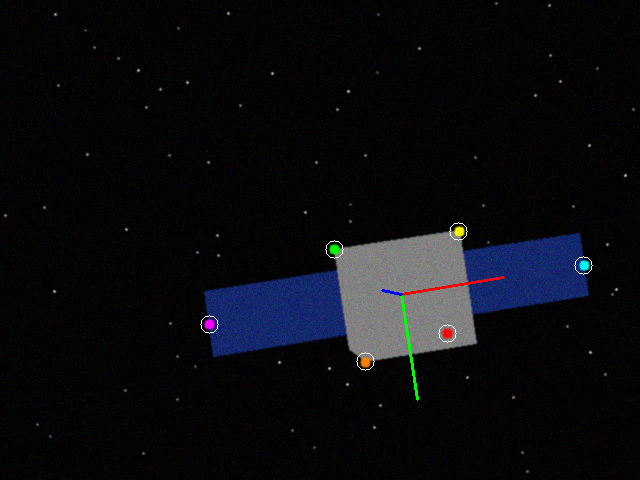

# satpose

Estimating a satellite's 3D pose from a single camera image w. OpenCV



## What it does

1. **Generates synthetic data** (`generate.py`): renders 50 images of a simple satellite (body + solar panels) against a starfield at random rotations and distances (7 to 12 m). Six colored markers sit at known 3D points on the satellite. Each image gets blur and Gaussian noise to look more like a real sensor, and the true pose is saved to `truth.csv`.
2. **Preprocesses and detects** (`estimate.py`): Gaussian blur, HSV color thresholding, and morphological opening to clean the masks, then contour detection to find each marker's center.
3. **Estimates pose**: matches the 2D detections to their known 3D points and solves for rotation and translation with `cv2.solvePnP` (SQPnP).
4. **Validates**: compares every estimate against ground truth and reports position error and rotation error (geodesic angle between rotation matrices).

## Results (50 images)

| Metric | Value |
|---|---|
| Images solved | 50 / 50 |
| Mean position error | 4.38 cm |
| Mean rotation error | 0.37° |
| Worst rotation error | 1.45° |

Per-image numbers r in `results.csv`.

## Run it!!!!!!!!!!!!

```
pip install -r requirements.txt
python generate.py
python estimate.py
```
(generate makes the images)

## Limitations / next steps

- Markers are always drawn, even when they woudlbe hidden behind the body in real life.
- Real satellites don't have colored markers, so the next step is detecting natural features (corners, edges) or training a keypoint model. :(
- Add harsher conditions: lens distortion, glare, motion blur, partial occlusion, camera warping, etc etc etc.
